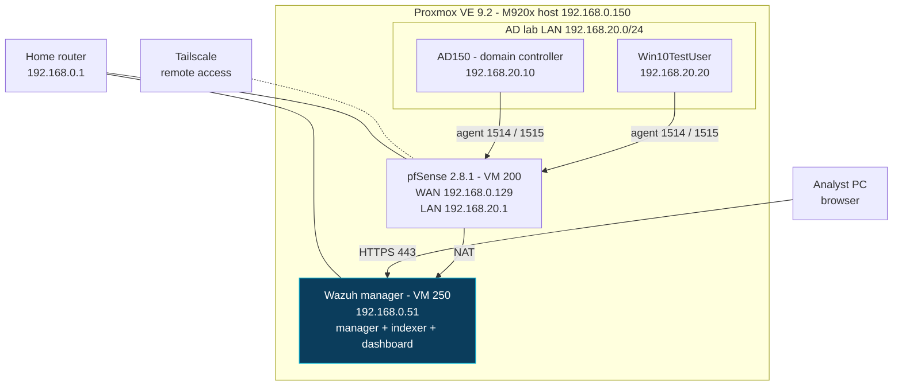
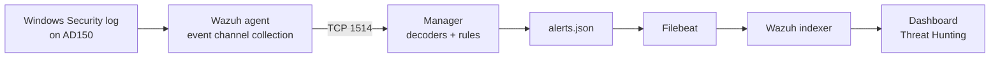
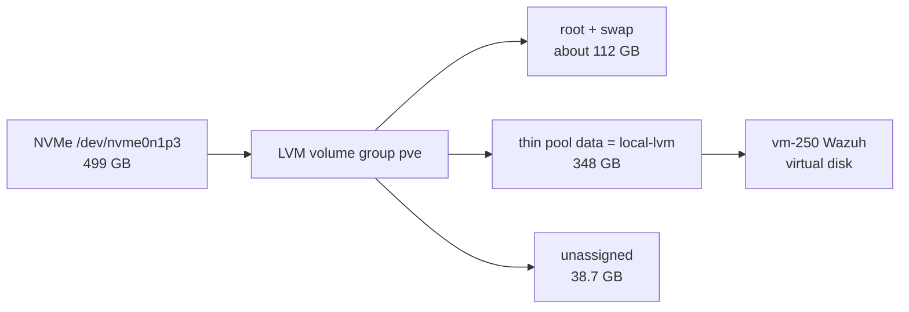

# Enterprise-Scale Wazuh SIEM Homelab

> A Wazuh 4.14 all-in-one SIEM monitoring a Windows Server 2019 domain controller and a domain-joined Windows 10 client behind pfSense. This repo documents the configuration, the log pipeline, and the detections validated end to end.


https://github.com/user-attachments/assets/2ab1bf13-8dd9-4e92-a6e5-b51482fbdb16


**Contents**

1. [Overview](#overview)
2. [Architecture](#architecture)
3. [Lab inventory](#inventory)
4. [Network path for the SIEM](#network)
5. [Monitored directory](#ad)
6. [Wazuh server configuration](#wazuh)
7. [Agent enrollment](#agents)
8. [Windows audit policy (GPO)](#gpo)
9. [Log pipeline](#pipeline)
10. [Detection validation](#detections)
11. [Troubleshooting log](#troubleshooting)
12. [Security considerations and limitations](#security)
13. [Roadmap](#roadmap)
14. [Skills demonstrated](#skills)

---

<a id="overview"></a>
## 🔭 Overview

This lab is a detection-focused environment built on a single Proxmox node. A **Wazuh all-in-one SIEM** monitors a **Windows Server 2019 domain controller** (a 474-user Active Directory domain) and a **domain-joined Windows 10 client**. Both sit behind a **pfSense** firewall, and **Tailscale** provides remote access.

The goal was to practice the whole loop that a SOC or MSP security team runs, not just the install:

1. Deploy the SIEM and give it a stable, restricted network path.
2. Enroll the endpoints.
3. Configure Windows auditing so the right events exist in the first place.
4. Generate suspicious behavior on purpose.
5. Confirm the SIEM detects it, trace the event through the log pipeline, and document what broke along the way.

### 📌 At a glance

| | |
|---|---|
| **SIEM** | Wazuh 4.14 all-in-one (manager, indexer, dashboard) |
| **Endpoints monitored** | 2: AD150 (domain controller) and Win10TestUser (domain-joined client) |
| **Directory** | `dezerradigital.local`, 474 user accounts organized by department (PowerShell-generated) |
| **Firewall / router** | pfSense CE 2.8.1, routed lab LAN, alias-scoped rule for the Wazuh agent path |
| **Remote access** | Tailscale on pfSense |
| **Auditing** | Windows Advanced Audit Policy delivered by GPO |
| **Detections verified** | Rule `60122` (failed logon) and rule `60204` (multiple failed logons) |
| **Baseline posture** | CIS Windows Server 2019 benchmark: **25%** (89 passed, 258 failed) before hardening |

> **Scope note:** Hardening the domain is covered in a separate deep-dive repo (see the [GPO section](#gpo)). This repo covers the SIEM, its network path, the endpoint configuration, and the logs and detections.

---

<a id="architecture"></a>
## 🏗️ Architecture



### 🧭 Design decisions

| Decision | Reasoning | Trade-off |
|---|---|---|
| **Manager lives on the home LAN, not inside the lab LAN** | The lab LAN needs one outbound path to the SIEM, and no inter-VLAN routing has to exist yet. | Traffic is NAT'd through pfSense, so the manager sees pfSense as the network source. Agent identity comes from enrollment (name and ID). |
| **Alias-based pfSense rule** | `AD_LAB_AGENTS`, `WAZUH_MGR`, and `WAZUH_AGENT_PORTS` aliases keep the rule readable and editable in one place. | The default LAN allow-any rule still exists for general egress (see [limitations](#security)). |
| **Single all-in-one Wazuh node** | Wazuh's quickstart sizing covers up to 25 agents on one host, which fits a two-agent lab. | No high availability. |
| **Static address outside the DHCP pool** | Router DHCP hands out `.100`-`.249`, so the manager uses `192.168.0.51` and can never collide with a lease. | None. |
| **Audit policy by GPO, not local `auditpol`** | Settings are centrally managed, reviewable, and repeatable. | Needs correct link order and precedence (see [troubleshooting](#troubleshooting)). |

---

<a id="inventory"></a>
## 🗂️ Lab inventory

| VM | VMID | OS | Address | Role |
|---|---|---|---|---|
| **pfSense** | 200 | pfSense CE 2.8.1 (FreeBSD, amd64) | WAN `192.168.0.129` (DHCP) / LAN `192.168.20.1/24` | Router, firewall, Tailscale |
| **Wazuh-Manager** | 250 | Ubuntu 26.04 | `192.168.0.51/24` (static) | Wazuh manager, indexer, dashboard |
| **AD150** | 150 | Windows Server 2019 Standard (Evaluation), build 17763 | `192.168.20.10/24` | Domain controller for `dezerradigital.local`, Wazuh agent `001` |
| **Win10TestUser** | 1501 | Windows 10, build 19045 | `192.168.20.20/24` | Domain-joined client, Wazuh agent |

**Hypervisor:** Proxmox VE 9.2, node `DeZerraDigital` (M920x) at `192.168.0.150:8006`.


*Figure 1: Proxmox node with the four VMs that make up this lab.*

---

<a id="network"></a>
## 🌐 Network path for the SIEM

### pfSense interfaces

| Interface | Device | Address | Purpose |
|---|---|---|---|
| **WAN** | `vtnet0` | `192.168.0.129/24` (DHCP) | Uplink to the home LAN, NAT for lab traffic |
| **LAN** | `vtnet1` | `192.168.20.1/24` | Gateway for the AD lab |


*Figure 2: pfSense console showing interface assignment.*

### Firewall rule for Wazuh agents

Aliases (Firewall → Aliases):

| Alias | Type | Contents |
|---|---|---|
| `AD_LAB_AGENTS` | Host(s) | `192.168.20.10`, `192.168.20.20` |
| `WAZUH_MGR` | Host(s) | `192.168.0.51` |
| `WAZUH_AGENT_PORTS` | Port(s) | `1514`, `1515` |

LAN rule:

| Field | Value |
|---|---|
| Action | Pass |
| Protocol | TCP |
| Source | `AD_LAB_AGENTS` |
| Destination | `WAZUH_MGR` |
| Destination ports | `WAZUH_AGENT_PORTS` |
| Logging | Enabled |
| Description | Wazuh agents to manager (1514 events, 1515 enrollment) |


*Figure 3: LAN rules showing the scoped Wazuh rule.*

### Ports used by the SIEM

| Port | Protocol | Purpose | Path |
|---|---|---|---|
| `443` | TCP | Wazuh dashboard (HTTPS) | Analyst PC → manager |
| `1514` | TCP | Agent event channel | Agents → manager |
| `1515` | TCP | Agent enrollment | Agents → manager |
| `55000` | TCP | Wazuh server API | Administrative use |

### Remote access

Tailscale is set up on pfSense and is currently used to reach a desktop computer remotely, without opening inbound ports. Extending it to more lab hosts and applications is on the [roadmap](#roadmap).

---

<a id="ad"></a>
## 🏢 Monitored directory

| Item | Value |
|---|---|
| **Domain** | `dezerradigital.local` |
| **Domain controller** | AD150 (Windows Server 2019) |
| **Population** | 474 user accounts, generated with a PowerShell script, spread across department OUs with matching security groups |
| **Client** | Win10TestUser, domain-joined |

```text
dezerradigital.local
├── Builtin
├── Computers
├── Domain Controllers          (AD150)
├── ForeignSecurityPrincipals
├── Lab
│   ├── Groups                  (GRP-* security groups, for example GRP-Engineering)
│   └── Users
│       ├── Engineering
│       ├── Finance
│       ├── HR
│       ├── IT                  (contains sub-OUs)
│       └── Sales
├── Managed Service Accounts
└── Users
```

A realistic population matters for detection work: logon failures, Kerberos ticket requests, and group changes all look different against a few accounts than against a directory with real departmental structure.


*Figure 4: `Lab` OU structure with department OUs and group membership.*

---

<a id="wazuh"></a>
## 🛡️ Wazuh server configuration

### Phase 1: Build the VM

| Setting | Value |
|---|---|
| OS | Ubuntu 26.04 |
| CPU | 3 vCPU (1 socket) |
| Memory | about 5 GiB |
| Disk | 95 GiB (see [troubleshooting](#troubleshooting)) |
| Network | VirtIO on `vmbr0` (home LAN) |

> Wazuh's quickstart guidance for up to 25 agents is 4 vCPU, 8 GiB RAM, and 50 GB storage. This two-agent lab runs below the RAM recommendation, and raising it is on the [roadmap](#roadmap).

### Phase 2: Static address

Ubuntu Desktop manages networking through NetworkManager, so the address is set with `nmcli` rather than by editing a netplan file.

```bash
sudo nmcli connection modify "netplan-ens18" \
  ipv4.method manual \
  ipv4.addresses 192.168.0.51/24 \
  ipv4.gateway 192.168.0.1 \
  ipv4.dns "192.168.0.1 1.1.1.1"
sudo nmcli connection up "netplan-ens18"
sudo hostnamectl set-hostname wazuh-manager
```

### Phase 3: Install (all-in-one)

```bash
curl -sO https://packages.wazuh.com/4.14/wazuh-install.sh
head -n 3 wazuh-install.sh        # should start with #!/bin/bash
sudo bash ./wazuh-install.sh -a
```

The installer prints the dashboard `admin` credentials once at the end. They are stored in a password manager and are never committed to this repo.

### Phase 4: Verify

```bash
sudo systemctl status wazuh-manager wazuh-indexer wazuh-dashboard --no-pager
sudo ss -tlnp | grep -E ':(1514|1515|55000|443) '
```

All three services report `active (running)` and the four ports are listening. The dashboard is reachable at `https://192.168.0.51` (self-signed certificate).


*Figure 5: Manager, indexer, and dashboard services running.*

### Key files and logs

| Location | Purpose |
|---|---|
| Manager: `/var/ossec/etc/ossec.conf` | Manager configuration, including the agent listener on `1514/TCP` and the enrollment service on `1515`. Left at install defaults. |
| Manager: `/var/ossec/ruleset/rules/` | Built-in rules that produce alerts such as `60122` and `60204` |
| Manager: `/var/ossec/logs/ossec.log` | Manager daemon log: agent connections, enrollment, errors |
| Manager: `/var/ossec/logs/alerts/alerts.json` | Every alert the rules produce, one JSON object per line |
| Manager: `/var/ossec/logs/alerts/alerts.log` | The same alerts in plain-text form |
| Indexer and dashboard | `sudo journalctl -u wazuh-indexer -u wazuh-dashboard` |
| Windows agent: `C:\Program Files (x86)\ossec-agent\ossec.conf` | Agent configuration: manager address and the event channels to collect |
| Windows agent: `C:\Program Files (x86)\ossec-agent\ossec.log` | Agent log: enrollment and connection to the manager |

Only events that match a rule become alerts, and full raw-event archiving is off by default.

---

<a id="agents"></a>
## 🔌 Agent enrollment

| Agent name | Host | Address | Version |
|---|---|---|---|
| `AD150` | Domain controller | `192.168.20.10` | 4.14.9 |
| `Win10TestUser` | Domain-joined client | `192.168.20.20` | 4.14.9 |

The deploy command comes from the dashboard (Agents → Deploy new agent), pointed at the manager:

```powershell
Invoke-WebRequest -Uri https://packages.wazuh.com/4.x/windows/wazuh-agent-4.14.9-1.msi -OutFile $env:tmp\wazuh-agent
msiexec.exe /i $env:tmp\wazuh-agent /q WAZUH_MANAGER='192.168.0.51' WAZUH_AGENT_NAME='AD150'
Start-Service WazuhSvc
Get-Service WazuhSvc
```

The MSI installs the agent but leaves the service **stopped**, so it must be started explicitly. Reachability from the lab was confirmed before enrolling:

```powershell
Test-NetConnection 192.168.0.51 -Port 1514
Test-NetConnection 192.168.0.51 -Port 1515
```

The default Windows agent configuration already reads the Security, System, and Application event channels, so no agent configuration change was needed to collect the audit events described below.


*Figure 6: Both agent ports reachable from AD150 through pfSense.*


*Figure 7: Both agents showing as active in the dashboard.*


*Figure 8: AD150 enrolled as agent `001`, status active, with system inventory, SCA, and MITRE views populated.*

---

<a id="gpo"></a>
## 📜 Windows audit policy (GPO)

> **This section covers only the audit policy needed for SIEM visibility.** Full domain hardening (password policy, privilege restrictions, tiering, and so on) is a separate deep-dive: [Active Directory Hardening Lab](https://github.com/dzenan27/Active-Directory-Hardening-Lab).

Wazuh can only alert on events Windows actually writes. A domain controller's default audit settings are thin, so a dedicated GPO (`DZD - DC Audit Policy`) turns on the Advanced Audit Policy subcategories that matter for identity attacks.

| Subcategory | Setting | Key event IDs | Why it matters |
|---|---|---|---|
| Credential Validation | Success, Failure | `4776` | NTLM validation against the DC: brute force and spray |
| Kerberos Authentication Service | Success, Failure | `4768`, `4771` | TGT requests and pre-auth failures |
| Kerberos Service Ticket Operations | Success, Failure | `4769` | Service ticket requests, the signal behind Kerberoasting |
| Logon | Success, Failure | `4624`, `4625` | Successful and failed interactive and network logons |
| Logoff | Success | `4634` | Session timeline |
| User Account Management | Success, Failure | `4720`, `4722`, `4723`, `4724`, `4725`, `4738` | Account creation, enablement, password changes, disablement |
| Security Group Management | Success, Failure | `4728`, `4732`, `4756` | Changes to privileged group membership |

The policy also enables **"Audit: Force audit policy subcategory settings to override audit policy category settings"** under Security Options, so the advanced subcategories take precedence over the legacy basic audit categories.

### ✅ Verifying the policy

```powershell
gpupdate /force
gpresult /scope computer /r
auditpol /get /category:"Account Logon","Logon/Logoff","Account Management"
reg query HKLM\SYSTEM\CurrentControlSet\Control\Lsa /v SCENoApplyLegacyAuditPolicy   # expect 0x1
```

The settings are also stored in the GPO's `audit.csv` in SYSVOL, where the last column shows `3` for Success and Failure and `1` for Success only:

```powershell
$id = (Get-GPO -Name "DZD - DC Audit Policy").Id
Get-Content "\\dezerradigital.local\SYSVOL\dezerradigital.local\Policies\{$id}\Machine\Microsoft\Windows NT\Audit\audit.csv"
```

<details>
<summary><b>📸 GPO screenshots</b></summary>

<br/>


*Figure 9: Advanced Audit Policy settings in `DZD - DC Audit Policy`.*


*Figure 10: The audit GPO listed under applied Group Policy Objects.*


*Figure 11: `auditpol` reporting Success and Failure on the audited subcategories.*

</details>

---

<a id="pipeline"></a>
## 🪵 Log pipeline



A single failed logon travels this path:

1. The domain controller writes event `4625` (and `4776` for NTLM validation) to its Security log because the audit policy tells it to.
2. The Wazuh agent reads the event and forwards it to the manager over `1514/TCP`.
3. The manager decodes the event and matches it against the ruleset, producing an alert (for example `60122`).
4. The alert is appended to `alerts.json`, shipped to the indexer by Filebeat, and becomes searchable in the dashboard.

If an alert is missing, checking each hop in order isolates the fault: the Windows Security log, then the agent's `ossec.log`, then the manager's `ossec.log`, then `alerts.json`, then the dashboard.

---

<a id="detections"></a>
## 🎯 Detection validation

### 🧪 Test

Incorrect-password authentication attempts were run repeatedly from a command prompt on AD150. The resulting alerts were then pulled from the Wazuh manager.

### 🔎 Inspecting the raw alerts on the manager

<!-- CONFIRM: replace these with the exact commands or screenshot you used to pull the logs from the manager -->

```bash
# How many failed-logon alerts exist
sudo grep -c '"id":"60122"' /var/ossec/logs/alerts/alerts.json

# Most recent multiple-failure correlation alert
sudo grep '"id":"60204"' /var/ossec/logs/alerts/alerts.json | tail -n 1
```

### 📊 Results

| Observation | Detail |
|---|---|
| **Rule `60122`** | "Logon Failure - Unknown user or bad password", level 5, fired for each failed attempt |
| **Rule `60204`** | "Multiple Windows Logon Failures", level 10, fired as a correlation alert once failures stacked up |
| **Timing** | Individual failures from about 03:00 to 03:02, correlation alert at 03:01:58 |
| **Counters (AD150, 24 h)** | 892 total events, 243 authentication successes, 11 authentication failures, 0 alerts at level 12 or above |
| **Event groups observed** | `windows`, `windows_security`, `sca`, `authentication_success`, `authentication_failed`, `policy_changed`, `account_changed` |


*Figure 12: Threat Hunting dashboard for AD150.*


*Figure 13: Authentication-failure events, including the level 10 `60204` correlation alert.*


*Figure 14: Raw alert entries on the manager.*

### 📉 Baseline posture (before hardening)

Wazuh's Security Configuration Assessment ran the **CIS Microsoft Windows Server 2019 Benchmark v2.0.0** against AD150 straight after enrollment:

| Passed | Failed | Not applicable | Score |
|---|---|---|---|
| 89 | 258 | 0 | **25%** |

This is the "before" number for the [hardening lab](#gpo). Re-running the scan after hardening gives a measurable improvement. Early MITRE ATT&CK telemetry on the same agent surfaced Defense Evasion, Initial Access, Persistence, and Privilege Escalation tactics, and the PCI DSS compliance view was populated automatically.


*Figure 15: CIS Windows Server 2019 benchmark results for AD150.*

---

<a id="troubleshooting"></a>
## 🧯 Troubleshooting log

Problems hit while building this lab and how each was resolved.

<details>
<summary><b>1. Wazuh installer download returned an XML error instead of a script</b></summary>

<br/>

| | |
|---|---|
| **Symptom** | `./wazuh-install.sh: No such file or directory`, and `head` on the saved file showed `<?xml ... AccessDenied` |
| **Cause** | The unversioned `4.x` download path no longer served the installer, so curl saved the error response under the script's name |
| **Fix** | Use the versioned path from the Wazuh quickstart (`/4.14/`) and check the first lines with `head -n 3` before running anything downloaded |

</details>

<details>
<summary><b>2. Static IP on Ubuntu Desktop: no netplan file to edit</b></summary>

<br/>

| | |
|---|---|
| **Symptom** | `/etc/netplan` contained only installer and NetworkManager files, with no cloud-init file |
| **Cause** | Ubuntu Desktop uses NetworkManager as its network renderer |
| **Fix** | Set the address with `nmcli connection modify` on the existing profile. The old DHCP address remained as a second address until the connection was cycled |

</details>

<details>
<summary><b>3. Wazuh VM disk too small (25 GiB to 95 GiB)</b></summary>

<br/>

| | |
|---|---|
| **Symptom** | Only about 25 GiB for a stack that stores 90 days of indexed alerts |
| **Cause** | Default VM disk size, set before the sizing guidance was checked |
| **Fix** | Grow the layers in order: Proxmox virtual disk, then partition, then filesystem |

Where the disk actually lives:



| Layer | What it is | Notes |
|---|---|---|
| **Physical disk** | One NVMe partition, 499 GB | Handed to LVM as a single physical volume |
| **Volume group `pve`** | Pool of raw space carved into logical volumes | The LVM page shows 92% *assigned to volumes*, which is not the same as 92% *full* |
| **Thin pool `data`** (`local-lvm`) | 348 GB pool where every VM disk lives | 71.78 GB (21%) actually written at time of capture |
| **VM disk** | A virtual disk with a size promise | Space is only consumed as the guest writes data, so growing a disk costs nothing up front |
| **Inside the guest** | Partition, then filesystem | Resizing the virtual disk does not grow these automatically |

Steps:

1. Proxmox: VM 250 → Hardware → Hard Disk → Disk Action → Resize.
2. Inside the VM:

```bash
echo 1 | sudo tee /sys/class/block/sda/device/rescan   # guest sees the new disk size
sudo apt install -y cloud-guest-utils                    # provides growpart
sudo growpart /dev/sda 2                                 # grow the root partition
sudo resize2fs /dev/sda2                                 # grow the ext4 filesystem
df -h /                                                  # verify
```


*Volume group `pve`, 499 GB, with 38.7 GB unassigned.*


*Thin pool `data`, 348 GB, 21% used.*


*Wazuh VM hardware tab.*

</details>

<details>
<summary><b>4. Win10TestUser: no space to install the agent, and "Extend Volume" was greyed out</b></summary>

<br/>

| | |
|---|---|
| **Symptom** | About 300 MB free on `C:`, and Disk Management would not extend the volume into the unallocated space |
| **Cause** | The 546 MB Recovery partition sits between `C:` and the free space, and Windows can only extend into adjacent space |
| **Fix** | `reagentc /disable`, delete the Recovery partition with `diskpart` (`delete partition override`), `extend` the system partition, then `reagentc /enable` |


*Recovery partition blocking `C:` from extending into the 20 GB of unallocated space.*

</details>

<details>
<summary><b>5. Agent installed but not running</b></summary>

<br/>

| | |
|---|---|
| **Symptom** | `Get-Service *wazuh*` showed `WazuhSvc` as `Stopped` and no agent appeared in the dashboard |
| **Cause** | The MSI installs the service without starting it |
| **Fix** | `Start-Service WazuhSvc`, then confirm the connection in `C:\Program Files (x86)\ossec-agent\ossec.log` and check the Agents list |

</details>

<details>
<summary><b>6. pfSense web interface unreachable from the lab</b></summary>

<br/>

| | |
|---|---|
| **Symptom** | Browsers timed out or reported the site could not be found at `https://192.168.20.1` |
| **Cause** | The pfSense GUI was being served over HTTP in this setup, so the HTTPS URL did not answer |
| **Fix** | Use `http://192.168.20.1`. Layer 2 was verified first with `ping` and `arp -a` on AD150 (the pfSense MAC resolved correctly) |

</details>

<details>
<summary><b>7. GPO audit settings not taking effect (<code>auditpol</code> still showed "Success" only)</b></summary>

<br/>

| | |
|---|---|
| **Symptom** | After `gpupdate /force`, `auditpol` reported only `Success` on audited subcategories, with no `Failure` events |
| **Diagnosis** | `gpresult` listed the GPO as applied. `audit.csv` in SYSVOL held the correct values (`3` = Success and Failure). The override registry value `SCENoApplyLegacyAuditPolicy` was `0x1`. That left GPO link order and precedence as the cause: the policy applied but did not win |
| **Fix** | Reordered the GPO in Group Policy Management and forced a refresh with `gpupdate /force`. `auditpol` then reported Success and Failure |

</details>

---

<a id="security"></a>
## 🔐 Security considerations and limitations

**What is in place**
- Agent traffic to the manager is limited to two ports (`1514` events, `1515` enrollment) from two named hosts by an alias-scoped, logged rule.
- The dashboard is HTTPS-only, and remote access uses Tailscale rather than port forwards.
- Generated credentials and the installer's `wazuh-install-files.tar` are kept out of this repo.
- Detection testing used incorrect-password attempts only, with no changes to real accounts.

**Known limitations (documented on purpose)**
- The default "LAN to any" allow rules still exist on pfSense for general egress, so the Wazuh rule documents and logs the intended path rather than being the only permitted one. A default-deny posture is on the roadmap.
- Single-node, all-in-one Wazuh deployment with no high availability.
- Manager memory is below Wazuh's recommended 8 GiB for its size class.
- The dashboard uses a self-signed certificate.
- AD150 runs a Windows Server evaluation licence.

---

<a id="roadmap"></a>
## 🧭 Roadmap

- [ ] Move pfSense LAN to default-deny with explicit allows (DNS, updates, Wazuh)
- [ ] Raise Wazuh manager memory to the recommended 8 GiB
- [ ] Extend Tailscale access to more lab hosts and applications
- [ ] Move the manager into the cyber-lab VLAN with scoped inter-VLAN routing
- [ ] Add Sysmon on endpoints for process creation and network telemetry
- [ ] Custom Wazuh rules for AD-specific attacks (Kerberoasting, group membership changes)
- [ ] Re-run the CIS benchmark after hardening and publish the before/after comparison
- [ ] Publish the Active Directory Hardening Lab deep-dive

---

<a id="skills"></a>
## 🧰 Skills demonstrated

| Area | Shown by |
|---|---|
| **SIEM deployment** | Wazuh all-in-one install, sizing against vendor guidance, service verification, agent enrollment |
| **Identity and AD logging** | Advanced Audit Policy design mapped to event IDs for brute force, Kerberos abuse, and group changes |
| **Log pipeline analysis** | Tracing an event from the Windows Security log through the agent, manager, `alerts.json`, and dashboard |
| **Network segmentation** | pfSense routed lab, alias-based least-privilege rule, NAT path reasoning |
| **Detection engineering** | Controlled failed-logon test, rule `60122` to `60204` correlation, CIS baseline |
| **Troubleshooting and documentation** | Root-cause write-ups with symptom, cause, and fix for each issue |

---

**Related:** [Profile](https://github.com/dzenan27) • [Active Directory Hardening Lab](https://github.com/dzenan27/Active-Directory-Hardening-Lab)


